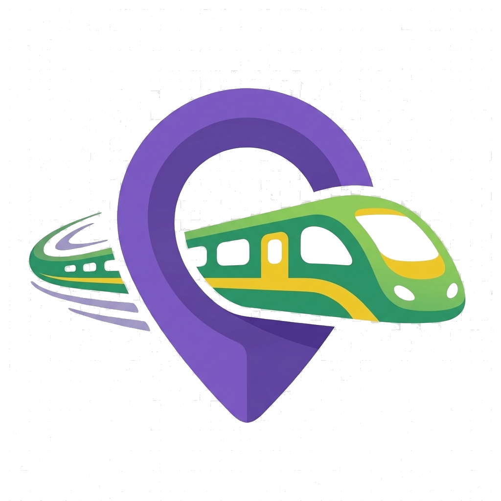

<div align="center">

  

  # 🚇 NammaRide Website: Bengaluru Metro Route Planner
  ### Official Web Platform & Interactive Simulator for Bengaluru Namma Metro (BMRCL)

  [](https://www.nammaride.site/)
  [](https://play.google.com/store/apps/details?id=site.nammaride.app)
  [](https://www.nammaride.site/simulator)

  <br/>

  <a href="https://play.google.com/store/apps/details?id=site.nammaride.app" target="_blank" rel="noopener noreferrer">
    
  </a>

</div>

---

## 🛠️ Technology Stack & Web Architecture

| Category | Tools & Libraries |
| :--- | :--- |
| **Framework & Build** |    |
| **Styling & Design System** |    |
| **Icons & Visuals** |  |
| **SEO, GEO & AEO** | JSON-LD Structured Schemas (`SoftwareApplication`, `FAQPage`, `TransitSystem`), `llms.txt`, `llms-full.txt` |
| **Localization** | Trilingual Support: English, Kannada (ಕನ್ನಡ), and Hindi (हिन्दी) |

---

## 🚀 Quick Start Commands

```bash
# 1. Install dependencies
npm install

# 2. Run local development server (http://localhost:5173)
npm run dev

# 3. Build optimized production bundle to dist/
npm run build

# 4. Preview production build locally
npm run preview
```

---

## 🌐 Live Canonical Navigation

- **Official Web Domain**: [https://www.nammaride.site/](https://www.nammaride.site/)
- **Interactive Simulator**: [https://www.nammaride.site/simulator](https://www.nammaride.site/simulator)
- **Stations Directory**: [https://www.nammaride.site/stations](https://www.nammaride.site/stations)
- **Timetables & Frequencies**: [https://www.nammaride.site/timings](https://www.nammaride.site/timings)
- **Fare & Smart Card Savings Calculator**: [https://www.nammaride.site/fare-calculator](https://www.nammaride.site/fare-calculator)
- **Interactive Metro Map**: [https://www.nammaride.site/map](https://www.nammaride.site/map)
- **Commuter Blog & Guides**: [https://www.nammaride.site/blog](https://www.nammaride.site/blog)
- **Google Play Android App**: [Download NammaRide](https://play.google.com/store/apps/details?id=site.nammaride.app)
